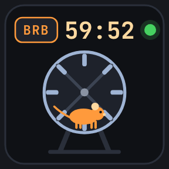
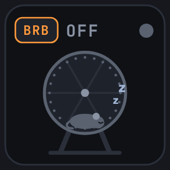
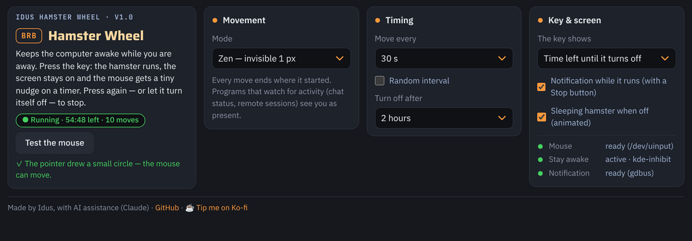

# Idus Hamster Wheel

An **[OpenDeck](https://github.com/nekename/OpenDeck)** key (Stream Deck on Linux) that keeps your computer awake while you are away. Press it and a hamster starts running: the screen does not lock, the computer does not sleep, and the mouse gets a tiny nudge on a timer. It turns itself off after the time you choose. Press again to stop.

| Running | Asleep |
|---|---|
|  |  |

## What it does

- **One key, one press.** The orange **BRB** tab, a green lamp and the time left while it runs; the hamster sleeps when it is off.
- **Stays awake.** Blocks the screen lock and sleep while it runs — through KDE's `kde-inhibit`, or `systemd-inhibit` on other desktops.
- **Moves the mouse a little** on a timer, so programs that watch for activity (chat status, remote sessions) see you as present. Every move ends where it started.
- **Turns itself off** after 15 min – 4 h (or never), and tells you in a notification.
- **Notification while it runs**, with a **Stop** button — so you can see it is on even when the deck is out of sight.
- **Leaves nothing behind.** Everything it starts ends with the plugin: no services, no system changes, no autostart.



## Settings

| Setting | Choices | Default |
|---|---|---|
| **Mode** | **Zen** — 1 px and back, invisible · **Nudge** — a few px and back · **Circle** — a small circle · **Random** — small jiggles · **Stay awake only** — no mouse movement | Zen |
| **Distance** | 1 – 20 px (Nudge, Circle, Random) | 4 px |
| **Move every** | 15 s – 10 min, or a **random interval** between two times | 30 s |
| **Turn off after** | 15 min, 30 min, 1 h, 2 h, 4 h or never | 1 h |
| **The key shows** | time left · time since you pressed it · countdown to the next move | time left |
| **Notification** | on / off | on |
| **Sleeping hamster when off** | animated / still | animated |

**Test the mouse** in the settings panel draws a small circle with the pointer, so you can see that moving works. The panel also shows what this computer supports (mouse, stay awake, notification).

Several Hamster Wheel keys all show the same wheel — any of them starts or stops it. Switching pages on the deck does not stop it.

## Requirements

- **OpenDeck** 2.x and **Node.js 22 or newer** (`sudo pacman -S nodejs` on Arch/CachyOS).
- For moving the mouse: **python3** and write access to **`/dev/uinput`** — see below. Works on Wayland and X11: the desktop sees an ordinary mouse called "Idus Hamster Wheel".
- For staying awake: `kde-inhibit` (KDE Plasma) or `systemd-inhibit`.
- For the notification: `gdbus` (part of glib2, on practically every desktop).

Made for and tested on **CachyOS with KDE Plasma 6** and the native OpenDeck package. The OpenDeck Flatpak runs plugins in a sandbox that may block `/dev/uinput` and `kde-inhibit`.

## Install

One line (downloads the latest release):

```bash
curl -fsSL https://github.com/Idus/idus-hamster-wheel/releases/latest/download/install-idus-hamster-wheel.sh | bash
```

Or from a clone: `bash install-idus-hamster-wheel.sh`. Or let **[Idus GitHub Updater](https://github.com/Idus/idus-github-updater)** install it and keep it up to date — it is in its list of Idus apps.

Then **quit OpenDeck from its tray icon** and start it again. The key is under **Idus Hamster Wheel** in the action list: **BRB · Hamster Wheel**. The installer checks what this computer supports and fetches the Idus fonts (Saira, IBM Plex Sans, JetBrains Mono) to `~/.local/share/fonts/idus` if they are missing.

### Mouse access (`/dev/uinput`)

The mouse is moved through a small virtual mouse, which needs write access to `/dev/uinput`. Steam's controller support usually allows this already — check with:

```bash
getfacl -p /dev/uinput | grep user
```

A line with your user name and `rw-` means you are set. If not, this udev rule gives the person at the computer access to it (the same way Steam does for controllers) — run it yourself; the plugin never changes system settings:

```bash
echo 'KERNEL=="uinput", SUBSYSTEM=="misc", TAG+="uaccess", OPTIONS+="static_node=uinput"' | sudo tee /etc/udev/rules.d/60-idus-uinput.rules && sudo udevadm control --reload && sudo udevadm trigger --name-match=uinput
```

No `/dev/uinput` at all: `sudo modprobe uinput && echo uinput | sudo tee /etc/modules-load.d/uinput.conf`.

Without mouse access the key still keeps the computer awake; it shows **NO MOUSE** with the reason for a few seconds and an amber lamp after that.

## Use it where you are allowed to

Some workplaces, exams and online games do not allow tools that simulate activity. Check their rules before you use it there.

## How it works

- `plugin.js` — the key, timers, auto-off and animation (one loop, only changed frames are sent).
- `lib/mover.py` — the virtual mouse, Python standard library only. Moves are capped at 50 px per step; it removes the virtual mouse and exits as soon as the plugin stops.
- `lib/desktop.js` — `kde-inhibit` / `systemd-inhibit` holding `tail --pid=<plugin>`, so the block ends with the plugin even if it is killed; the notification through `gdbus`.
- No network access, no telemetry, nothing written to disk.

## Uninstall

```bash
bash install-idus-hamster-wheel.sh --uninstall
```

## Credits

- Built for **[OpenDeck](https://github.com/nekename/OpenDeck)** by nekename.
- Same look as **[Idus SC Deck](https://github.com/Idus/idus-sc-deck)**.
- Code written with AI assistance (Claude).

## Support

If the hamster saves your day: **[☕ Tip me on Ko-fi](https://ko-fi.com/N4N2QZHKK)**

## License

MIT — see `LICENSE`. Fonts used on the key: Saira, IBM Plex Sans and JetBrains Mono (SIL Open Font License), installed separately.
